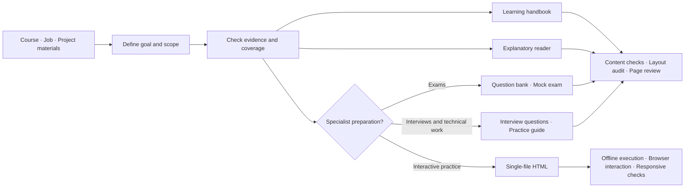

<div align="center">

# Study Fast

### Turn a stack of materials into understanding you can use.

Learning handbooks · Explanatory readers · Question banks & mock exams · Practice guides · Single-file HTML quizzes

[简体中文](README.md) · [All outputs](#available-outputs) · [Quick start](#quick-start) · [Examples](#describe-your-goal)


[](LICENSE)

</div>

---

Study Fast turns course slides, textbooks, assignments, job descriptions and project evidence into reusable learning documents. Each output has a clear role, from building foundations to practising exam answers, interview explanations and technical tasks.

**Understand with the reader. Look things up in the handbook. Check your skills through questions and practice.**

## Available outputs

The core documents complement each other and remain independently readable. Assessment and practical preparation extend the learning workflow.

There are **five Word output types and one standalone HTML module**. Output filenames can reflect the course or role.

| Output | Format / identifier | Contents and purpose | Selection |
| :--- | :--- | :--- | :--- |
| **Learning handbook** | `.docx` · `study_handbook` | Prerequisites, definitions, equations, derivations, worked examples and limitations | Default core document |
| **Explanatory reader** | `.docx` · `teaching_narrative` | Connected explanations from intuition to mechanisms and applications | Default core document |
| **Question bank and answers** | `.docx` · `question_bank` | Questions grouped by type or competency, with the required solution steps; includes interview follow-ups | On request |
| **Mock exam** | `.docx` · `mock_exam` | Questions, duration, checked point totals and reference answers | On request |
| **Practice guide** | `.docx` · `practice_guide` | Code, SQL, experiments, debugging or system design, with environment, solutions and verification | When technical practice is needed and `practice_needed` is enabled |
| **Interactive quiz** | One `.html` · `interactive_quiz` | Categories, search, numbered navigation, sequential/random sessions, hidden answers, self-assessment, review and local progress | Opt-in; can be generated alone |

The default pack contains the two core documents, adding a practice guide only when technical practice is needed. You can also request individual documents or an explicit combination.

### HTML means one self-contained file

The bank, styles and scripts are embedded. Open the HTML directly while offline: no accompanying JSON, images, fonts, scripts, resource folders or server are required. Wide screens show side navigation; narrow screens collapse settings so the question comes first. Progress lives in the browser; exporting a backup is an optional user action, not a runtime dependency.

The default interface uses **device system fonts** for headings, body text and controls, with normal-weight question text and separately collapsible numbered navigation. Optional per-question `title` and `learning` fields add a short heading and collapsible help below the prompt: concepts, working method, explanations, worked examples and pitfalls. Missing fields produce no empty panels; existing configurations remain valid. Teaching content must be authored from evidence; the template does not infer knowledge or difficulty. Browser math fonts may be used for properly structured equations without changing the system font for interface text.

Self-assessment is not objective grading. Drafts survive question navigation within the page but are cleared on refresh. The current template handles plain text, line breaks and Unicode, without built-in LaTeX or Markdown rendering. See the [quiz contract](references/interactive-quiz.md). Word typography and native-equation rules do not automatically apply to HTML.

### Choose a combination

| Goal | Outputs | Files |
| :--- | :--- | :--- |
| Learn a course | Handbook + reader | 2 Word files |
| Exam preparation with repeated practice | Handbook + reader + question bank + HTML | 3 Word files + 1 HTML |
| One mock exam | Mock exam | 1 Word file |
| Browser practice only | HTML | 1 HTML |
| Interview preparation involving coding | Handbook + reader + interview question bank + practice guide; optionally HTML | 4 Word files, optionally 1 HTML |

All five Word types and the HTML module are selectable; all six outputs are never generated by default. HTML uses a separate entry point and is not a sixth type in the Word configuration schema.



## From understanding to independent answers

Recognising an explanation is different from recalling it without help. Read, attempt an answer, compare it with the reference, and return to the reader or handbook where needed. Then try a variation.

| Scenario | Preparation focus |
| :--- | :--- |
| **Coursework and exams** | Scope, assignments, supplied exam questions, prerequisite knowledge and problem variations |
| **Interviews** | Role competencies, real project evidence, technical questions and relevant coding exercises |
| **Work onboarding** | Responsibilities, processes, systems, risks and practical tasks |
| **Progress reports, meetings and defenses** | Goals, methods, evidence, limitations and likely challenges |

Inferred questions are never presented as guaranteed exam content. Generated reference answers are not official answer keys. Missing or illegible source details remain uncertain.

## A consistent academic layout

Explicit formatting rules reduce variation between runs. User templates and approved manual edits take precedence.

| Element | Default |
| :--- | :--- |
| Page and body | A4; 12 pt; 1.5 line spacing; two-character indent for Chinese prose |
| Fonts | SimSun and Times New Roman, with Cambria Math fallback for mathematical glyphs |
| Tables and equations | Three-line tables and editable native Word equations, including matrices |
| Question banks | Academic blue questions and black answers; optional black print style |
| Layout | No running header; configurable cover, contents and answer placement |
| Sharing | Internal evidence records are not automatically printed; check identities, comments and revisions |

Final documents also need rendering and page-by-page review. Structural checks alone cannot establish correct pagination, mathematical validity or complete learning coverage.

## Quick start

```bash
git clone https://github.com/Gusuhanfeng/study-fast.git ~/.codex/skills/study-fast
cd ~/.codex/skills/study-fast
python -m pip install -r requirements.txt
```

Refresh or restart Codex, then invoke `$study-fast` with your materials, goal and requested outputs. Keep private sources and generated artifacts outside the skill repository.

## Describe your goal

```text
Use $study-fast to build a handbook and explanatory reader from these slides.
I am a beginner: include the necessary foundations. Each document must stand alone.
```

```text
Use this exam scope, homework and supplied questions to improve my handbook.
Create a question bank grouped by question type, containing only questions and answers.
Add evidence-informed variations. Use native equations, three-line tables and no header.
```

```text
Prepare a learning pack and interview questions from this JD and anonymized experience.
Add runnable exercises where coding is required. Do not invent project achievements.
```

```text
Read my latest manually edited Word document before revising it.
Preserve its colors, indentation and header settings; do not overwrite it with an old generator.
```

```text
Use $study-fast to generate only an interactive quiz from these materials, without Word files.
Deliver exactly one self-contained HTML that works offline, with embedded questions and resources.
Group questions by chapter, hide answers initially and support review of weak topics.
```

```text
Use $study-fast to create a handbook, reader and question bank, plus one offline HTML quiz.
Deliver 3 Word files and 1 HTML. Keep shared questions and reference answers consistent.
```

<details>
<summary><strong>CLI and configuration</strong></summary>

Start with the [core example](assets/pack-config.example.json), [question-bank example](examples/question-bank.json), or [mock-exam example](examples/mock-exam.json). These demonstrate the configuration interface, not complete course content.

The [interactive quiz example](examples/interactive-quiz.json) is a separate internal configuration for HTML.

```bash
python scripts/build_pack.py --config examples/question-bank.json --check-only
python scripts/build_pack.py --config examples/question-bank.json --output-dir ../study-output
python scripts/audit_docx.py ../study-output/question-bank.docx --config examples/question-bank.json
python scripts/self_check.py
python -m unittest discover -s tests -v
```

Build only the offline quiz and deliver just `quiz.html`:

```bash
python scripts/build_quiz.py --config examples/interactive-quiz.json --check-only
python scripts/build_quiz.py --config examples/interactive-quiz.json --output ../study-output/quiz.html
```

The HTML generator needs only the Python standard library. See the [quiz schema](assets/interactive-quiz.schema.json); do not pass this configuration to the Word generator. Both generators reject overwriting existing artifacts by default.

`full_pack` preserves the two core outputs plus practice when needed. `selected` supports explicitly requested combinations. Theory question banks do not require `practice_needed=true`.

Use the same configuration for generation and auditing. See the [schema](assets/pack-config.schema.json) and [output contract](references/output-contract.md) for document types and layout overrides.

</details>

<details>
<summary><strong>Evidence and privacy</strong></summary>

| Status | Meaning |
| :--- | :--- |
| `VERIFIED` | Directly supported by current materials or reliable sources |
| `USER_STATED` | Explicitly stated by the user, not independently verified |
| `INFERRED` | Reasonable inference, including newly designed question variations |
| `UNKNOWN` | Missing, conflicting or unconfirmed information |

Keep the coverage and evidence ledger internal unless requested. Preserve assumptions needed for an answer to hold. Do not upload private course, career or project materials without authorization.

Read the latest artifact before editing it. Preserve manual changes and report checks that could not be completed.

</details>

## Explore the project

| Entry | Contents |
| :--- | :--- |
| [SKILL.md](SKILL.md) | Skill entry point and workflow |
| [Learning design](references/learning-design.md) | Complementary, independently readable core documents |
| [Assessment design](references/assessment-design.md) | Question banks, mock exams and practical preparation |
| [Interactive quiz](references/interactive-quiz.md) | Single-file HTML generation, interaction, progress and offline checks |
| [Document layout](references/formal-document-template.md) | Fonts, indentation, tables and equations |
| [Scenario playbooks](references/scenario-playbooks.md) | Task-specific preparation workflows |
| [Contributing](CONTRIBUTING.md) · [Security](SECURITY.md) | Development checks and privacy boundaries |

---

<div align="center">

**Understand → Look up → Practise → Transfer**

[MIT License](LICENSE) · [中文文档](README.md)

</div>
