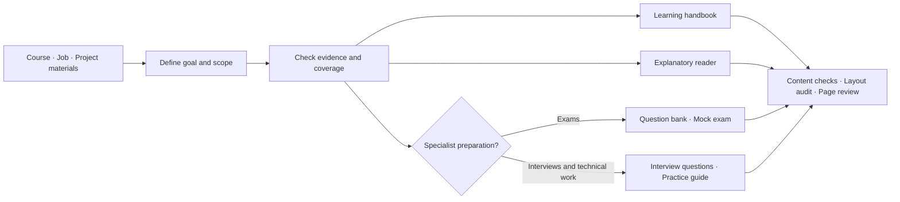

<div align="center">

# Study Fast

### Turn a stack of materials into understanding you can use.

Learning handbooks · Explanatory readers · Question banks & mock exams · Practical preparation

[简体中文](README.md) · [Quick start](#quick-start) · [Examples](#describe-your-goal)


[](LICENSE)

</div>

---

Study Fast turns course slides, textbooks, assignments, job descriptions and project evidence into reusable learning documents. Each output has a clear role, from building foundations to practising exam answers, interview explanations and technical tasks.

**Understand with the reader. Look things up in the handbook. Check your skills through questions and practice.**

## Two core documents, three optional extensions

The core documents complement each other and remain independently readable. Assessment and practical preparation extend the learning workflow.

| Document | Experience | Purpose |
| :--- | :--- | :--- |
| **Learning handbook** | Textbook structure with prerequisites, definitions, equations, examples and limitations | Cover the agreed scope and revisit gaps |
| **Explanatory reader** | Connected prose with few headings, moving from intuition to mechanisms | Follow a complete explanation |
| **Question bank** | Questions and answers grouped by type or competency | Practise recall, variations and follow-up questions |
| **Mock exam** | Questions, checked point totals and a separate answer section | Rehearse an exam structure |
| **Practice guide** | Code, SQL, experiments, debugging or system design | Execute or reproduce technical work |

The default pack contains the two core documents, adding a practice guide only when technical practice is needed. You can also request individual documents or an explicit combination.



## From understanding to independent answers

Recognising an explanation is different from recalling it without help. Read, attempt an answer, compare it with the reference, and return to the reader or handbook where needed. Then try a variation.

| Scenario | Preparation focus |
| :--- | :--- |
| **Coursework and exams** | Scope, assignments, supplied exam questions, prerequisite knowledge and problem variations |
| **Interviews** | Role competencies, real project evidence, technical questions and relevant coding exercises |
| **Work onboarding** | Responsibilities, processes, systems, risks and practical tasks |
| **Progress reports, meetings and defenses** | Goals, methods, evidence, limitations and likely challenges |

Inferred questions are never presented as guaranteed exam content. Generated reference answers are not official answer keys. Missing or illegible source details remain uncertain.

## A consistent academic layout

Explicit formatting rules reduce variation between runs. User templates and approved manual edits take precedence.

| Element | Default |
| :--- | :--- |
| Page and body | A4; 12 pt; 1.5 line spacing; two-character indent for Chinese prose |
| Fonts | SimSun and Times New Roman, with Cambria Math fallback for mathematical glyphs |
| Tables and equations | Three-line tables and editable native Word equations, including matrices |
| Question banks | Academic blue questions and black answers; optional black print style |
| Layout | No running header; configurable cover, contents and answer placement |
| Sharing | Internal evidence records are not automatically printed; check identities, comments and revisions |

Final documents also need rendering and page-by-page review. Structural checks alone cannot establish correct pagination, mathematical validity or complete learning coverage.

## Quick start

```bash
git clone https://github.com/Gusuhanfeng/study-fast.git ~/.codex/skills/study-fast
cd ~/.codex/skills/study-fast
python -m pip install -r requirements.txt
```

Refresh or restart Codex, then invoke `$study-fast` with your materials, goal and requested outputs. Keep private sources and generated artifacts outside the skill repository.

## Describe your goal

```text
Use $study-fast to build a handbook and explanatory reader from these slides.
I am a beginner: include the necessary foundations. Each document must stand alone.
```

```text
Use this exam scope, homework and supplied questions to improve my handbook.
Create a question bank grouped by question type, containing only questions and answers.
Add evidence-informed variations. Use native equations, three-line tables and no header.
```

```text
Prepare a learning pack and interview questions from this JD and anonymized experience.
Add runnable exercises where coding is required. Do not invent project achievements.
```

```text
Read my latest manually edited Word document before revising it.
Preserve its colors, indentation and header settings; do not overwrite it with an old generator.
```

<details>
<summary><strong>CLI and configuration</strong></summary>

Start with the [core example](assets/pack-config.example.json), [question-bank example](examples/question-bank.json), or [mock-exam example](examples/mock-exam.json). These demonstrate the configuration interface, not complete course content.

```bash
python scripts/build_pack.py --config examples/question-bank.json --check-only
python scripts/build_pack.py --config examples/question-bank.json --output-dir ../study-output
python scripts/audit_docx.py ../study-output/question-bank.docx --config examples/question-bank.json
python scripts/self_check.py
python -m unittest discover -s tests -v
```

`full_pack` preserves the two core outputs plus practice when needed. `selected` supports explicitly requested combinations. Theory question banks do not require `practice_needed=true`.

Use the same configuration for generation and auditing. See the [schema](assets/pack-config.schema.json) and [output contract](references/output-contract.md) for document types and layout overrides.

</details>

<details>
<summary><strong>Evidence and privacy</strong></summary>

| Status | Meaning |
| :--- | :--- |
| `VERIFIED` | Directly supported by current materials or reliable sources |
| `USER_STATED` | Explicitly stated by the user, not independently verified |
| `INFERRED` | Reasonable inference, including newly designed question variations |
| `UNKNOWN` | Missing, conflicting or unconfirmed information |

Keep the coverage and evidence ledger internal unless requested. Preserve assumptions needed for an answer to hold. Do not upload private course, career or project materials without authorization.

Read the latest artifact before editing it. Preserve manual changes and report checks that could not be completed.

</details>

## Explore the project

| Entry | Contents |
| :--- | :--- |
| [SKILL.md](SKILL.md) | Skill entry point and workflow |
| [Learning design](references/learning-design.md) | Complementary, independently readable core documents |
| [Assessment design](references/assessment-design.md) | Question banks, mock exams and practical preparation |
| [Document layout](references/formal-document-template.md) | Fonts, indentation, tables and equations |
| [Scenario playbooks](references/scenario-playbooks.md) | Task-specific preparation workflows |
| [Contributing](CONTRIBUTING.md) · [Security](SECURITY.md) | Development checks and privacy boundaries |

---

<div align="center">

**Understand → Look up → Practise → Transfer**

[MIT License](LICENSE) · [中文文档](README.md)

</div>
