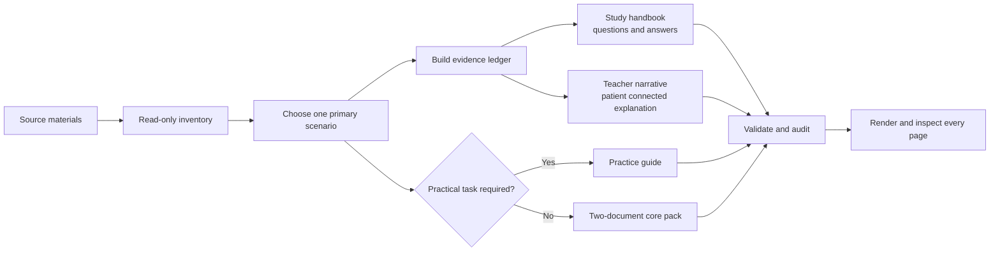
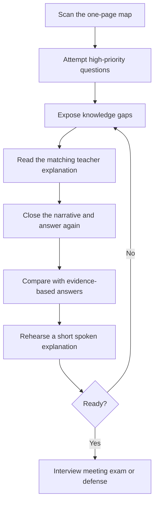

<div align="center">

# Study Fast

Turn source material into a question-and-answer handbook and a patient teacher-style explanation.

[简体中文](README.zh-CN.md)


</div>

Study Fast is an evidence-based Codex skill for rapid topic learning, exams, interviews, onboarding, weekly progress, meetings, and defenses. It converts course notes, job descriptions, project evidence, research records, or meeting materials into documents designed for learning and live performance.

## The core document pair

The two documents have different jobs. Their interaction is the main feature.

| Document | Role | What it contains | What the learner can do afterward |
| --- | --- | --- | --- |
| `study_handbook` | Lookup and rehearsal | Knowledge map, priorities, boundaries, likely questions, answers, answer frameworks, recall tasks, and a timed plan | Find key information quickly, answer from memory, and identify gaps |
| `teaching_narrative` | Understanding and explanation | Patient connected prose from an experienced teacher or manager perspective, with intuition, mechanisms, examples, mistakes, and application | Build a coherent mental model and explain the subject naturally |
| `practice_guide` | Optional technical practice | Runnable code, SQL, data work, experiments, debugging, demonstrations, or system design | Perform or reproduce a real technical task |

The practice guide is generated only when the source task contains a real practical requirement.



## The fast learning loop

Study Fast does not merely summarize files. It organizes the two documents around a repeatable learning cycle.



### Time-aware output

| Available time | Recommended focus |
| --- | --- |
| 15 minutes | One-page map, five critical questions and answers, one-minute explanation |
| 30–60 minutes | Core narrative, one worked example, three levels of questions, spoken rehearsal |
| 2 hours or more | Boundary cases, failure analysis, transfer exercises, second retrieval round |

When time is short, the skill reduces coverage instead of removing answers, evidence boundaries, or failure conditions.

## Supported scenarios

| Scenario | Handbook emphasis | Teacher narrative emphasis |
| --- | --- | --- |
| Knowledge point | Definitions, comparisons, misconceptions, recall and application questions | Intuition, mechanism, worked example, boundaries |
| Exam preparation | Scope, scoring points, representative questions and answer structures | How to recognize the tested concept and build an answer |
| Job interview | Capability evidence, project stories, technical and behavioral questions | How the role creates value and how to explain real decisions |
| Work onboarding | Responsibilities, process, systems, risks, escalation questions | A manager-style walkthrough of how the work fits together |
| Weekly progress | Goal, method, evidence, conclusion, limitations, likely follow-ups | A coherent research or project story with honest boundaries |
| Meeting or defense | Decisions, objections, risks, challenge questions and responses | How to explain the argument, evidence, tradeoffs, and limitations |

## Evidence and privacy

Claims use four evidence states:

| State | Meaning |
| --- | --- |
| `VERIFIED` | Directly supported by supplied material, code, logs, results, or a reliable source |
| `USER_STATED` | Stated by the user but not independently checked |
| `INFERRED` | A reasonable interpretation that remains explicitly labeled |
| `UNKNOWN` | Missing, conflicting, inaccessible, or unconfirmed |

Balanced privacy mode blocks private keys, likely real secrets, phone numbers, and task-specific prohibited terms. It warns about email addresses, absolute paths, UNC paths, and private URLs. Strict mode promotes those warnings to blocking findings. Obvious placeholders such as `<API_KEY>` and `YOUR_TOKEN` remain usable in technical teaching examples.

## Installation

Copy the repository into the Codex skills directory:

```text
~/.codex/skills/study-fast
```

Install the runtime dependency with Python 3.9 or newer:

```text
python -m pip install -r requirements.txt
```

Restart or refresh Codex. Invoke the skill with `$study-fast` or describe a matching preparation task.

## Example requests

```text
Use $study-fast to help me understand this paper topic in 45 minutes.
Create an interview handbook and teacher explanation from this JD and anonymized resume.
Turn these experiment records into a group-meeting preparation pack with likely questions and answers.
Prepare me for a defense using the manuscript, figures, and reviewer concerns.
```

<details>
<summary>CLI and configuration workflow</summary>

Start with `assets/pack-config.example.json`. Editors can use `assets/pack-config.schema.json` for completion and basic validation.

```text
python scripts/build_pack.py --config assets/pack-config.example.json --check-only
python scripts/build_pack.py --config assets/pack-config.example.json --output-dir output
python scripts/audit_docx.py output/*.docx
```

List templates:

```text
python scripts/build_pack.py --list-templates
```

Use `selection.output_mode=selected` for one requested document. See `examples/selected-handbook.json`.

</details>

<details>
<summary>Templates and visual verification</summary>

- `formal_zh_cn` uses SimSun and Times New Roman for Chinese Word environments.
- `formal_cross_platform` uses Noto Serif CJK SC and Liberation Serif.

The chosen template is recorded in DOCX metadata. Font declarations do not prove that fonts exist on the rendering machine. Render the final DOCX to page images and inspect every page before sharing it.

</details>

## Project structure

```text
study-fast/
├── SKILL.md                         Skill routing and operating rules
├── agents/openai.yaml               Codex display metadata
├── assets/                          Style catalog, example config, JSON Schema
├── examples/                        Minimal runnable configurations
├── references/                      Scenario, learning, privacy, and output contracts
├── scripts/                         Builder, auditor, shared checks, self-check
├── tests/                           Deterministic behavior and boundary tests
└── evals/                           Behavioral evaluation scenarios
```

The complete learning design is documented in [references/learning-design.md](references/learning-design.md).

## Development

```text
python scripts/self_check.py
python -m unittest discover -s tests -v
```

Generated documents, private configurations, and rendered pages must remain outside the repository. See [CONTRIBUTING.md](CONTRIBUTING.md) and [SECURITY.md](SECURITY.md).

## License

MIT © 2026 [gusuhanfeng](LICENSE)
