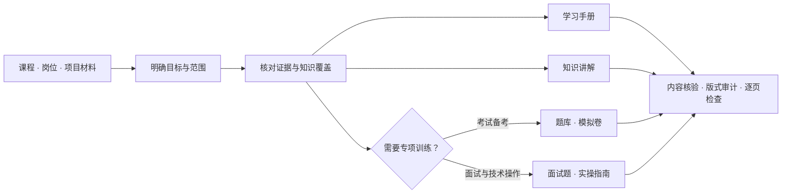
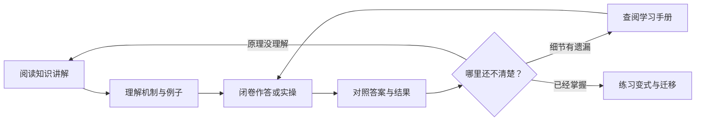

<div align="center">

# Study Fast

### 从一叠材料，到真正学懂、独立作答。

教材式学习手册 · 连贯知识讲解 · 题库与模拟卷 · 面试与实操

[English](README.en.md) · [快速开始](#快速开始) · [使用示例](#直接描述你的目标)


[](LICENSE)

</div>

---

Study Fast 将课件、教材、作业、岗位 JD 或项目材料，组织成可以反复使用的学习文档。从零基础建立理解，到考前练习、面试表达和实际操作，每份文档都有明确的任务。

**学懂原理，用知识讲解；系统查阅，用学习手册；检验掌握，用题库与实操。**

## 两份核心文档，三种按需拓展

两份核心文档相辅相成，也能独立阅读。考试与面试训练是拓展分支，不替代系统学习。

| 文档 | 阅读体验 | 解决的问题 |
| :--- | :--- | :--- |
| **学习手册** | 教材式结构，包含必要基础、定义、公式、例子与边界 | 系统学全约定范围，随时查阅与补缺 |
| **知识讲解** | 少标题、连贯段落，从直觉逐步走到机制和应用 | 理解为什么这样做，跟上完整思路 |
| **题库** | 按题型或能力分组，题目与答案对应 | 闭卷练习，适应条件变化与追问 |
| **模拟卷** | 完整题面、分值配置与集中答案 | 按考试结构演练，检查答题表现 |
| **实操指南** | 代码、SQL、实验、调试或系统设计任务 | 把理解转化为可执行、可复现的操作 |

默认生成两份核心文档；只有确实需要技术操作时才增加实操指南。也可以只选题库、模拟卷，或明确指定任意组合。



## 从理解到独立作答

阅读时觉得熟悉，不代表合上材料还能回答。Study Fast 把讲解、查阅和练习连接起来，让知识缺口能被发现，也能被补上。



### 面向考试，也面向真实任务

| 场景 | 准备重点 |
| :--- | :--- |
| **课程学习与考试** | 对照考试范围、作业与已提供试题；补齐先修基础，练习计算、推导与变式 |
| **面试准备** | 对照岗位能力和真实经历；组织技术问题、项目追问与必要代码练习 |
| **工作上手** | 理解职责、流程、系统与风险，练习实际操作 |
| **周进展、会议与答辩** | 串起目标、方法、证据与限制，准备可能的质询 |

题目可以依据现有材料作合理拓展，但不会把预测写成“必考”，也不会把生成的参考答案冒充官方答案。材料缺失或照片看不清时，保留不确定性。

## 固定版式，把注意力留给内容

采用明确的学术 Word 版式，减少每次生成时的格式漂移。已有模板和用户确认过的手工调整优先保留。

| 排版要素 | 默认约定 |
| :--- | :--- |
| 页面与正文 | A4；中文正文首行缩进两个汉字；12 pt、1.5 倍行距 |
| 中英文字体 | 宋体与 Times New Roman；数学字形允许 Cambria Math 后备 |
| 表格与公式 | 三线表；可编辑的 Word 原生公式，保留上下标、分式与矩阵 |
| 题库配色 | 学术蓝题目、黑色答案；可选择黑色打印版 |
| 文档布局 | 默认无页眉；封面、目录和答案位置可按文档配置 |
| 分享内容 | 内部证据账本不自动印入正文；检查身份信息、批注与修订痕迹 |

结构审计之外，还需要渲染最终文档，逐页检查分页、字形、公式和表格。程序检查通过不等于内容正确，也不等于版面已经验收。

## 快速开始

将仓库安装到 Codex 技能目录：

```bash
git clone https://github.com/Gusuhanfeng/study-fast.git ~/.codex/skills/study-fast
cd ~/.codex/skills/study-fast
python -m pip install -r requirements.txt
```

刷新或重启 Codex，使用 `$study-fast` 并提供材料、学习目标和需要的文档。私有材料与生成结果保存在技能仓库之外。

## 直接描述你的目标

**从零开始学一门课**

```text
用 $study-fast 根据这些课件和教材生成学习手册与知识讲解。
我是零基础，请补上必要的第0章。两份文档都要能独立阅读。
```

**针对期末考试训练**

```text
根据考试范围、平时作业和这些试题，优化学习手册，再生成题库。
题库按题型分，只保留题目与答案，并补充有依据的变式。
使用三线表、原生公式，题目学术蓝，答案黑色，不要页眉。
```

**准备面试与代码实践**

```text
根据这份JD和匿名项目经历，生成学习手册、知识讲解和面试题。
涉及编程的能力再配可运行练习；不要编造项目经历或成果。
```

**继续修订已有文档**

```text
读取我手工修改过的最新Word，只补齐遗漏的知识和题目。
保留已有配色、缩进与页眉设置，不要用旧脚本覆盖我的修改。
```

<details>
<summary><strong>命令行与配置：生成、审计和自检</strong></summary>

从以下示例选择起点。示例用于演示配置结构，不是完整课程内容。

| 配置 | 用途 |
| :--- | :--- |
| [核心文档](assets/pack-config.example.json) | 学习手册与知识讲解 |
| [题库](examples/question-bank.json) | 按题型组织题目与答案 |
| [模拟卷](examples/mock-exam.json) | 题目、分值与集中答案 |

```bash
python scripts/build_pack.py --config examples/question-bank.json --check-only
python scripts/build_pack.py --config examples/question-bank.json --output-dir ../study-output
python scripts/audit_docx.py ../study-output/question-bank.docx --config examples/question-bank.json
python scripts/self_check.py
python -m unittest discover -s tests -v
```

`full_pack` 保持两份核心文档，按需要增加实操；`selected` 用于明确选择文档组合。理论题库不要求开启 `practice_needed`。

生成与审计传入同一配置。每份文档可配置页眉、封面、目录、题目颜色、表格样式与答案位置。详细字段见 [JSON Schema](assets/pack-config.schema.json) 和 [输出契约](references/output-contract.md)。

</details>

<details>
<summary><strong>证据与隐私：哪些可以推断，哪些不能编造</strong></summary>

| 状态 | 含义 |
| :--- | :--- |
| `VERIFIED` | 当前资料、代码、日志或可靠来源直接支持 |
| `USER_STATED` | 用户明确陈述，尚未独立核验 |
| `INFERRED` | 基于材料的合理推断，例如新增练习变式 |
| `UNKNOWN` | 材料缺失、冲突或无法确认 |

证据账本用于内部核对覆盖与来源，不自动加入分享文档。保留影响答案成立的必要假设；未经授权，不上传私人课程、简历或项目资料。

局部修订先读取最新成品，保留用户手改。无法完成数学核验或逐页渲染时，如实说明，不宣称已经通过。

</details>

## 项目导航

| 入口 | 内容 |
| :--- | :--- |
| [SKILL.md](SKILL.md) | 技能入口与工作流程 |
| [学习设计](references/learning-design.md) | 两份核心文档如何互补并保持独立 |
| [应试与实操](references/assessment-design.md) | 题库、模拟卷与技术实践的设计规则 |
| [固定版式](references/formal-document-template.md) | 字体、缩进、三线表与公式规范 |
| [场景手册](references/scenario-playbooks.md) | 不同学习与准备任务的组织方式 |
| [贡献指南](CONTRIBUTING.md) · [安全说明](SECURITY.md) | 开发验证与隐私边界 |

---

<div align="center">

**理解 → 查阅 → 练习 → 迁移**

[MIT License](LICENSE) · [English documentation](README.en.md)

</div>
