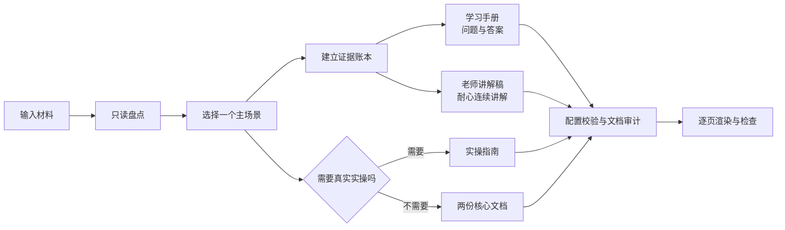
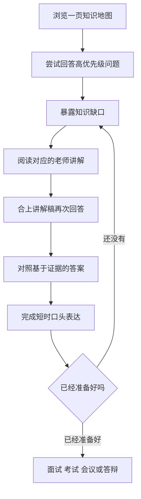

<div align="center">

# Study Fast

把现有材料转化为带问题答案的学习手册，以及老师视角的耐心讲解稿。

[English](README.md)


</div>

Study Fast 是一个证据导向的 Codex Skill，适用于知识点速学、考试复习、面试准备、工作上手、周进展汇报、会议和答辩。它读取课程笔记、岗位 JD、项目证据、研究记录或会议资料，生成真正服务于学习和现场表现的文档。

## 两份核心文档

两份文档承担不同任务，它们之间的配合是 Study Fast 的核心能力。

| 文档 | 角色 | 主要内容 | 学完后能够做到什么 |
| --- | --- | --- | --- |
| `study_handbook` | 查阅和应答训练 | 知识地图、优先级、边界、可能问题、参考答案、作答框架、回忆练习和时间计划 | 快速找到重点、闭卷回答并发现缺口 |
| `teaching_narrative` | 理解和讲解 | 老师或资深上级视角的耐心连续讲解，包括直觉、机制、例子、错误和应用 | 建立完整认知模型，并自然地向别人解释 |
| `practice_guide` | 可选技术实操 | 可运行代码、SQL、数据操作、实验、调试、演示或系统设计 | 实际执行或复现技术任务 |

只有当前任务确实要求技术实操时，才生成第三份实操指南。



## 快速学习闭环

Study Fast 不只是总结材料，而是让两份文档共同推动学习者完成一轮可重复的训练。



### 根据可用时间裁剪

| 可用时间 | 建议重点 |
| --- | --- |
| 15 分钟 | 一页地图、5 个关键问题及答案、1 分钟表达 |
| 30–60 分钟 | 核心讲解、一个完整例子、三层问题、口头演练 |
| 2 小时以上 | 边界案例、失败分析、迁移练习、第二轮主动回忆 |

时间不足时减少覆盖面，不删除答案、证据边界和失败条件。

## 支持的场景

| 场景 | 学习手册重点 | 老师讲解稿重点 |
| --- | --- | --- |
| 知识点速学 | 定义、对比、误区、回忆题和应用题 | 直觉、机制、完整例子和边界 |
| 考试复习 | 考试范围、得分点、代表题和答案结构 | 如何识别考点并组织答案 |
| 面试准备 | 能力证据、项目故事、技术与行为问题 | 岗位如何创造价值，以及如何解释真实决策 |
| 工作上手 | 职责、流程、系统、风险和升级问题 | 像直属上级一样讲清工作如何运转 |
| 周进展汇报 | 目标、方法、证据、结论、限制和追问 | 用诚实边界串起研究或项目故事 |
| 会议或答辩 | 决策、异议、风险、挑战问题及回答 | 如何解释论点、证据、权衡和限制 |

## 证据与隐私

所有重要事实使用四级证据状态：

| 状态 | 含义 |
| --- | --- |
| `VERIFIED` | 当前材料、代码、日志、结果或可靠来源直接支持 |
| `USER_STATED` | 用户明确陈述，但尚未独立核验 |
| `INFERRED` | 基于材料的合理推断，并保持明确标注 |
| `UNKNOWN` | 缺失、冲突、无法访问或无法确认 |

平衡隐私模式会阻止私钥、疑似真实密钥、电话号码和任务禁止词，并对邮箱、绝对路径、UNC 路径和内网地址发出警告。严格模式会把这些警告升级为阻止项。`<API_KEY>`、`YOUR_TOKEN` 等明显占位符仍可用于技术教学。

## 安装

将仓库复制到 Codex 技能目录：

```text
~/.codex/skills/study-fast
```

使用 Python 3.9 或更高版本安装依赖：

```text
python -m pip install -r requirements.txt
```

重启或刷新 Codex，然后使用 `$study-fast`，或者直接描述符合场景的准备任务。

## 使用示例

```text
用 $study-fast 帮我在45分钟内学懂这个论文知识点。
根据这份JD和匿名简历生成面试学习手册与老师讲解稿。
把这些实验记录整理成组会准备包，并预测老师可能提出的问题和答案。
根据论文、图表和评审意见帮我准备答辩。
```

<details>
<summary>命令行与配置流程</summary>

以 `assets/pack-config.example.json` 为配置起点。编辑器可以使用 `assets/pack-config.schema.json` 进行补全和基础校验。

```text
python scripts/build_pack.py --config assets/pack-config.example.json --check-only
python scripts/build_pack.py --config assets/pack-config.example.json --output-dir output
python scripts/audit_docx.py output/*.docx
```

查看模板：

```text
python scripts/build_pack.py --list-templates
```

只生成指定文档时使用 `selection.output_mode=selected`，示例见 `examples/selected-handbook.json`。

</details>

<details>
<summary>模板与视觉检查</summary>

- `formal_zh_cn`：宋体与 Times New Roman，适合中文 Word 环境。
- `formal_cross_platform`：Noto Serif CJK SC 与 Liberation Serif。

所选模板会记录在 DOCX 元数据中。字体声明不代表渲染机器一定安装了字体，公开前仍须把最终 DOCX 渲染成逐页图片并检查。

</details>

## 项目结构

```text
study-fast/
├── SKILL.md                         Skill 路由和工作规则
├── agents/openai.yaml               Codex 展示信息
├── assets/                          样式、示例配置和 JSON Schema
├── examples/                        最小可运行配置
├── references/                      场景、学习、隐私和输出契约
├── scripts/                         生成器、审计器和自检工具
├── tests/                           确定性行为与边界测试
└── evals/                           行为评估场景
```

完整学习设计见 [references/learning-design.md](references/learning-design.md)。

## 开发与验证

```text
python scripts/self_check.py
python -m unittest discover -s tests -v
```

生成文档、私人配置和渲染页必须保存在仓库之外。贡献与安全说明见 [CONTRIBUTING.md](CONTRIBUTING.md) 和 [SECURITY.md](SECURITY.md)。

## 许可证

MIT © 2026 [gusuhanfeng](LICENSE)
